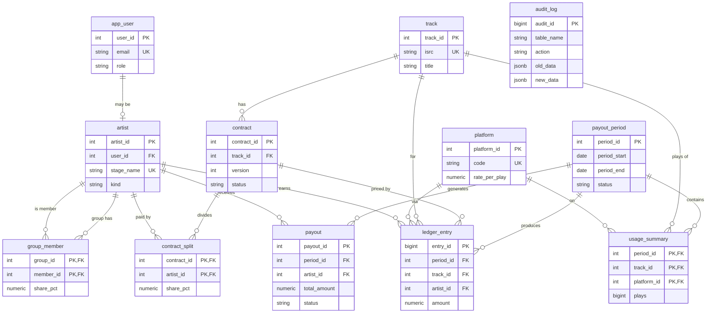

# Design: Transparent Royalty Split & Payout Ledger

## 1. Problem and objectives
Independent artists, producers and songwriters share earnings from a track through
opaque, spreadsheet-based splits that drift out of sync and cannot be audited.
This system keeps contractually exact split agreements and an auditable payout
ledger in PostgreSQL, and aggregates high-volume platform usage events in MongoDB,
so every payout traces back to the plays that produced it.

Objectives
1. Store split agreements that are provably complete (always exactly 100%).
2. Support nested splits (a band's share divided among its members, recursively).
3. Turn platform usage into an append-only, reconcilable ledger and one payout per artist per period.
4. Never pay anyone twice; never rewrite history.
5. Let artists see only their own earnings; let auditors see everything but change nothing.

## 2. Functional requirements
| # | Requirement | Role |
|---|---|---|
| F1 | Manage artists, groups and group membership shares | Admin |
| F2 | Manage tracks and versioned contracts (draft -> active -> superseded) | Admin |
| F3 | Upload platform usage reports (batches of events) | Admin |
| F4 | Void duplicate/bot events, purge voided events, raise and resolve disputes | Admin |
| F5 | Aggregate valid usage for a period and load it into PostgreSQL | Admin |
| F6 | Close a period: generate ledger entries and payouts atomically | Admin |
| F7 | Mark payouts as paid | Admin |
| F8 | View own earnings statements and payouts | Artist |
| F9 | View ledger, payouts and the audit trail (read-only) | Auditor |
| F10 | Search the catalogue (full-text) | All |

## 3. Database choice and justification
| Data | Store | Why |
|---|---|---|
| Artists, tracks, contracts, splits, periods, ledger, payouts, audit, users | **PostgreSQL** | Money needs ACID transactions, foreign keys, CHECK/UNIQUE/EXCLUDE constraints, triggers, row locking and row-level security. |
| Platform usage events and upload batches | **MongoDB** | Spotify/YouTube/Apple/radio reports have different fields; volume is high and append-heavy; records are corrected after arrival (void, dispute, purge). Schemaless documents plus aggregation pipelines fit; forcing this into relational columns would mean sparse tables or an EAV model. |

The two stores meet at one narrow interface: the Mongo aggregation output
`{ track_id, platform, plays }` is upserted into `usage_summary` (see API_CONTRACT.md).

## 4. ER diagram (also rendered as `docs/er-diagram.png`)

MongoDB (database `royalty_events`): `usage_batches` (one per uploaded report; embedded `notes[]`)
and `usage_events` (one per report row; `platform_payload` varies by platform; `track_id` and
`platform` reference PostgreSQL by value). Details in `mongo/init/01_init.js`.

## 5. Integrity and advanced features (where to find them)
| Concept | Implementation | File |
|---|---|---|
| Constraints | CHECK (shares, ISRC, email), UNIQUE, EXCLUDE (no overlapping periods), partial unique index (one active contract per track) | `sql/init/01_schema.sql` |
| Trigger | Contract activation requires shares = 100; split edits frozen once active; group member shares = 100 (deferred); cycle prevention | `sql/init/02_logic.sql` |
| Trigger | Ledger append-only, closed periods immutable, payout amounts frozen | `sql/init/02_logic.sql` |
| Trigger | Generic audit trail (`fn_audit`) on contract, split, group, period, payout, track | `sql/init/02_logic.sql` |
| Recursive CTE | `resolve_split()` expands nested groups to solo payees | `sql/init/02_logic.sql` |
| Stored procedure | `close_payout_period()` builds ledger + payouts in one transaction | `sql/init/02_logic.sql` |
| Functions | `activate_contract`, `create_contract_draft`, `mark_payout_paid`, `search_catalog` | `sql/init/02_logic.sql` |
| Transactions + locking | `FOR UPDATE` in period close and payout; rollback on any failure | `sql/init/02_logic.sql` |
| Views | `v_active_split`, `v_contract_overview`, `v_artist_statement`, `v_period_summary` | `sql/init/02_logic.sql` |
| Indexing | composite B-tree on ledger/usage, GIN full-text | `sql/init/01_schema.sql` |
| Full-text search | `to_tsvector` GIN index + `search_catalog()` | both |
| DB-level access control | roles `rl_admin/rl_artist/rl_auditor`, GRANTs, row-level security | `sql/init/03_roles.sql` |
| NoSQL aggregation | `aggregateUsagePipeline` ($match/$group/$project) | `mongo/pipelines/usage_ops.js` |
| NoSQL R/U/D | read (aggregate, find duplicates), update (void, dispute notes via $push), delete (purge voided, TTL index) | `mongo/pipelines/usage_ops.js` |

## 6. Architecture
```
Browser (Next.js pages: admin / artist / auditor)
   |
Next.js Route Handlers (auth, validation, role checks)
   |-- pg  ->  PostgreSQL  (SET LOCAL ROLE rl_*, app.user_id, app.artist_id per request)
   '-- mongodb driver -> MongoDB (usage_batches, usage_events)
```
Money flow: upload batch (Mongo) -> clean (void/dispute/purge) -> aggregate -> `usage_summary`
(Postgres) -> `CALL close_payout_period()` -> `ledger_entry` + `payout` -> `mark_payout_paid`.

## 7. Known simplifications
* Per-play rates are fixed per platform (not per period or country).
* Amounts are rounded to 4 decimals per ledger line; no residual-cent reallocation.
* Platforms are loaded from a reference table, not discovered from uploads.
