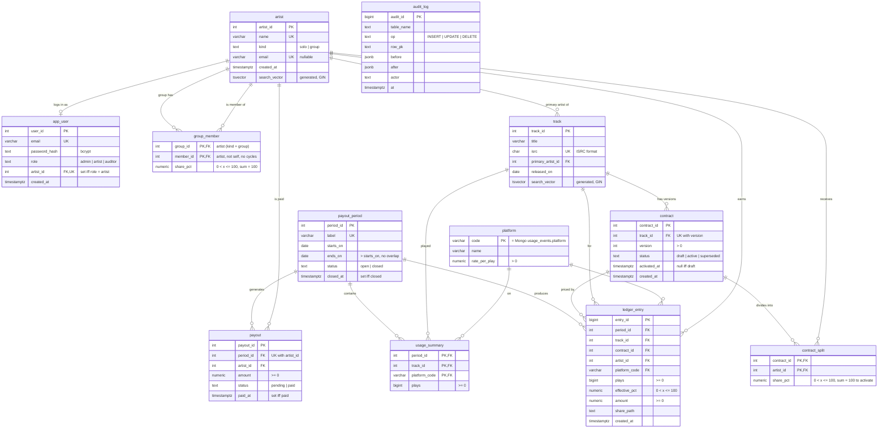

# Design: Transparent Royalty Split & Payout Ledger

## 1. Problem and objectives
Independent artists, producers and songwriters share earnings from a track through
opaque, spreadsheet-based splits that drift out of sync and cannot be audited.
This system keeps contractually exact split agreements and an auditable payout
ledger in PostgreSQL, and aggregates high-volume platform usage events in MongoDB,
so every payout traces back to the plays that produced it.

Objectives
1. Store split agreements that are provably complete (always exactly 100%).
2. Support nested splits (a band's share divided among its members, recursively).
3. Turn platform usage into an append-only, reconcilable ledger and one payout per artist per period.
4. Never pay anyone twice; never rewrite history.
5. Let artists see only their own earnings; let auditors see everything but change nothing.

## 2. Functional requirements
| # | Requirement | Role |
|---|---|---|
| F1 | Manage artists, groups and group membership shares | Admin |
| F2 | Manage tracks and versioned contracts (draft -> active -> superseded) | Admin |
| F3 | Upload platform usage reports (batches of events) | Admin |
| F4 | Void duplicate/bot events, purge voided events, raise and resolve disputes | Admin |
| F5 | Aggregate valid usage for a period and load it into PostgreSQL | Admin |
| F6 | Close a period: generate ledger entries and payouts atomically | Admin |
| F7 | Mark payouts as paid | Admin |
| F8 | View own earnings statements and payouts | Artist |
| F9 | View ledger, payouts and the audit trail (read-only) | Auditor |
| F10 | Search the catalogue (full-text) | All |

## 3. Database choice and justification
| Data | Store | Why |
|---|---|---|
| Artists, tracks, contracts, splits, periods, ledger, payouts, audit, users | **PostgreSQL** | Money needs ACID transactions, foreign keys, CHECK/UNIQUE/EXCLUDE constraints, triggers, row locking and row-level security. |
| Platform usage events and upload batches | **MongoDB** | Spotify/YouTube/Apple/radio reports have different fields; volume is high and append-heavy; records are corrected after arrival (void, dispute, purge). Schemaless documents plus aggregation pipelines fit; forcing this into relational columns would mean sparse tables or an EAV model. |

The two stores meet at one narrow interface: the Mongo aggregation output
`{ track_id, platform, plays }` replaces the period's rows in `usage_summary` (see API_CONTRACT.md).
The boundary is deliberately small and validated: unknown track ids or platform codes are rejected
before anything is written, so the relational side never holds data the document side invented.

## 4. ER diagram (rendered as `docs/er-diagram.png`)

`audit_log` has no foreign keys on purpose: it records rows of several tables and must outlive them.

### MongoDB collections (database `royalty_events`, `mongo/init/01_init.js`)
| Collection | Document | Indexes |
|---|---|---|
| `usage_batches` | `{ _id, period_id, platform, source_file, uploaded_by, uploaded_at, row_count, status: uploaded\|cleaned\|disputed\|aggregated, notes: [{ at, by, kind, text }] }` | `{period_id, status}` |
| `usage_events` | `{ batch_id, period_id, track_id, platform, plays, listener_hash, played_at, device, status: valid\|void, void_reason, raw }` | `{period_id, status}`, `{batch_id}`, `{track_id, platform, listener_hash, played_at}` |

Both have strict `$jsonSchema` validators. `raw` holds whatever extra fields a platform sends (Spotify playlist and
premium flag, YouTube watch seconds and ad support, Apple Music storefront and lossless), which is the main reason
these records live in a document store. `track_id`, `platform`, `period_id` and `uploaded_by` refer to PostgreSQL
rows by value; they are checked when a report is imported and again before aggregation.

## 5. Relational schema
Underlined = primary key, * = foreign key. Full DDL: `sql/init/01_schema.sql`.

| Relation | Attributes | Keys and constraints |
|---|---|---|
| artist | <u>artist_id</u>, name, kind, email, created_at, search_vector | name UNIQUE; email UNIQUE NULL; kind IN (solo, group) |
| app_user | <u>user_id</u>, email, password_hash, role, artist_id*, created_at | email UNIQUE; artist_id UNIQUE -> artist; CHECK (role = 'artist') = (artist_id IS NOT NULL) |
| group_member | <u>group_id*</u>, <u>member_id*</u>, share_pct | both -> artist; group_id <> member_id; 0 < share_pct <= 100; trigger: group is a group, no cycle; deferred trigger: shares = 100 |
| platform | <u>code</u>, name, rate_per_play | code ~ `^[a-z_]+$`; rate_per_play > 0 |
| track | <u>track_id</u>, title, isrc, primary_artist_id*, released_on, search_vector | isrc UNIQUE, ISRC format CHECK; GIN index on search_vector |
| contract | <u>contract_id</u>, track_id*, version, status, activated_at, created_at | UNIQUE (track_id, version); partial UNIQUE: one active and one draft per track; (status = draft) = (activated_at IS NULL) |
| contract_split | <u>contract_id*</u>, <u>artist_id*</u>, share_pct | 0 < share_pct <= 100; trigger: editable only while the contract is a draft |
| payout_period | <u>period_id</u>, label, starts_on, ends_on, status, closed_at | label UNIQUE; ends_on > starts_on; EXCLUDE overlapping date ranges; trigger: closed is final |
| usage_summary | <u>period_id*</u>, <u>track_id*</u>, <u>platform_code*</u>, plays | plays >= 0; trigger: no change once the period is closed |
| ledger_entry | <u>entry_id</u>, period_id*, track_id*, contract_id*, artist_id*, platform_code*, plays, effective_pct, amount, share_path, created_at | UNIQUE (period, track, platform, artist, share_path); amount >= 0; trigger: UPDATE/DELETE always fail |
| payout | <u>payout_id</u>, period_id*, artist_id*, amount, status, paid_at | UNIQUE (period_id, artist_id); (status = paid) = (paid_at IS NOT NULL); trigger: only pending -> paid, never deleted |
| audit_log | <u>audit_id</u>, table_name, op, row_pk, before, after, actor, at | op IN (INSERT, UPDATE, DELETE) |

Normalisation: every non-key attribute depends on the whole key and nothing else (3NF/BCNF). The ledger
deliberately copies `plays` and `effective_pct` at close time: it is a historical record, so it must not
change when a contract or usage row is later corrected (and those cannot change for a closed period anyway).

## 6. Integrity and advanced features (where to find them)
| Concept | Implementation | File |
|---|---|---|
| Constraints | CHECK (shares, ISRC, e-mail, role/artist), UNIQUE, EXCLUDE (no overlapping periods), partial unique indexes | `sql/init/01_schema.sql` |
| Triggers | contract lifecycle; splits draft-only; group shares = 100 (deferred constraint trigger); cycle prevention | `sql/init/02_logic.sql` |
| Triggers | ledger append-only; closed periods and their usage immutable; payouts pay-once and never deleted | `sql/init/02_logic.sql` |
| Trigger | generic audit trail `fn_audit` (before/after JSONB, acting user) on contract, contract_split, group_member, payout_period, payout | `sql/init/02_logic.sql` |
| Recursive CTE | `resolve_contract_split` / `resolve_split` expand nested groups to solo payees with a readable share path | `sql/init/02_logic.sql` |
| Stored procedure | `close_payout_period` builds ledger + payouts in one transaction | `sql/init/02_logic.sql` |
| Functions | `create_contract_draft`, `activate_contract`, `mark_payout_paid`, `search_catalog` | `sql/init/02_logic.sql` |
| Transactions + locking | `FOR UPDATE` on period, contract and payout rows; any failure rolls back everything | `sql/init/02_logic.sql` |
| Views | `v_active_split`, `v_contract_overview`, `v_artist_statement`, `v_period_totals` (all `security_invoker`) | `sql/init/02_logic.sql` |
| Indexing | composite B-tree on ledger/usage/payout, GIN full-text on track and artist | `sql/init/01_schema.sql` |
| DB-level access control | roles `rl_admin`, `rl_artist`, `rl_auditor`; GRANTs; row-level security on `ledger_entry` and `payout` | `sql/init/03_roles.sql` |
| DDL demo | CREATE / ALTER ADD COLUMN + CONSTRAINT / CREATE INDEX / DROP | `sql/demo/ddl_demo.sql` |
| NoSQL | collections, validators, indexes, aggregation, void/dispute/purge | `mongo/` |

## 7. Architecture
```
Browser (Next.js pages: admin / artist / auditor)
   |
Next.js Route Handlers (session check, zod validation, role checks)
   |-- pg      -> PostgreSQL  (per request: BEGIN; SET LOCAL ROLE rl_*; app.user_id; app.artist_id)
   '-- mongodb -> MongoDB     (usage_batches, usage_events)
```
Money flow: upload batch (Mongo) -> clean (void duplicates/bot plays, dispute, purge) -> aggregate per
track+platform -> `usage_summary` (Postgres) -> `CALL close_payout_period(period)` -> `ledger_entry` +
`payout` -> `mark_payout_paid(payout)`.

## 8. Known simplifications
* Per-play rates are fixed per platform (not per period or country).
* Ledger lines are rounded to 4 decimals and payouts to 2; no residual-cent reallocation.
* Platforms are a reference table, not discovered from uploads.
