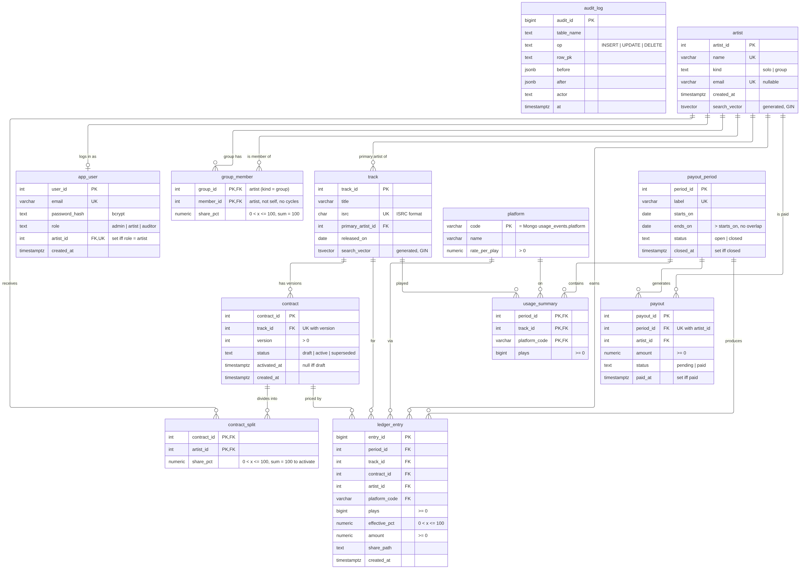
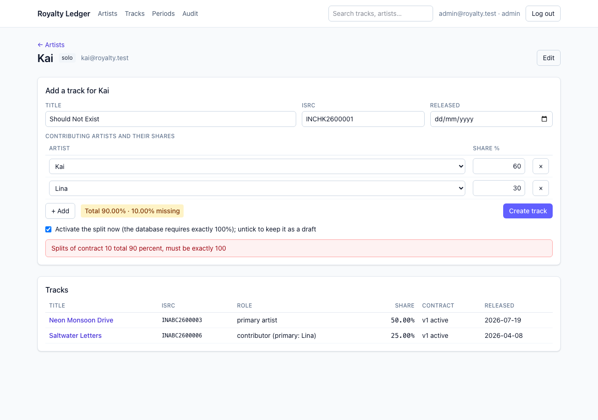
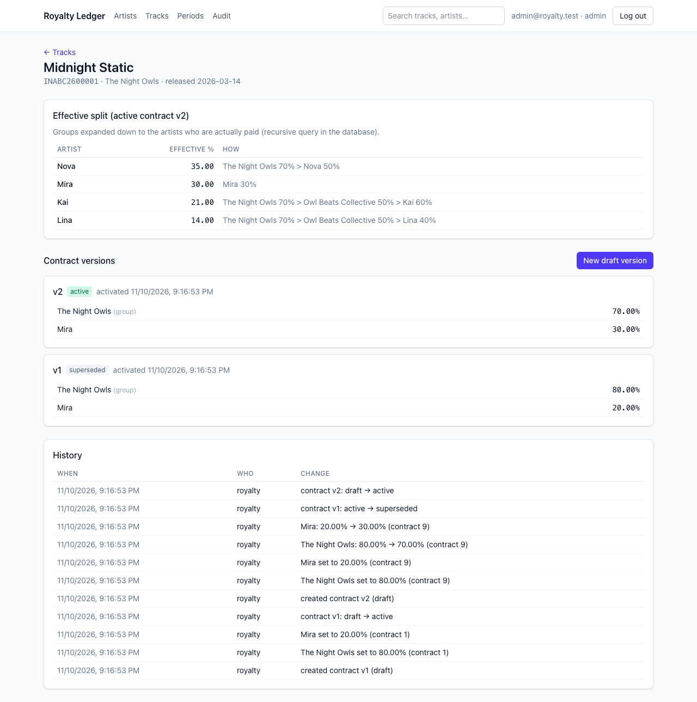
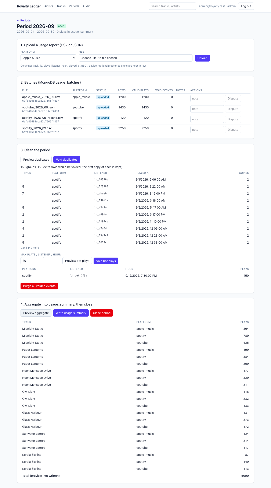
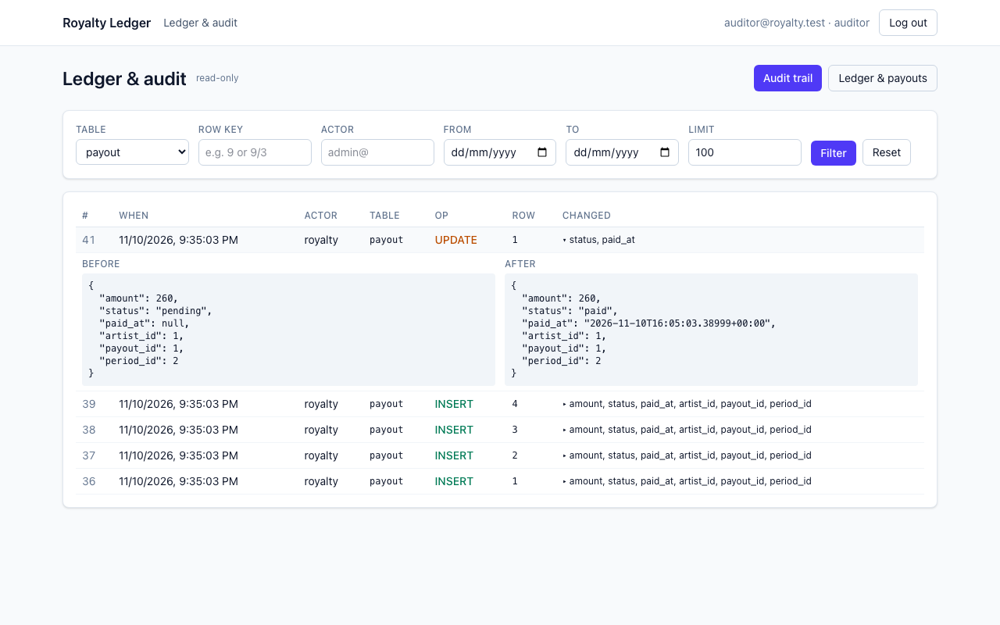
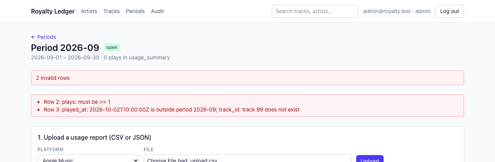
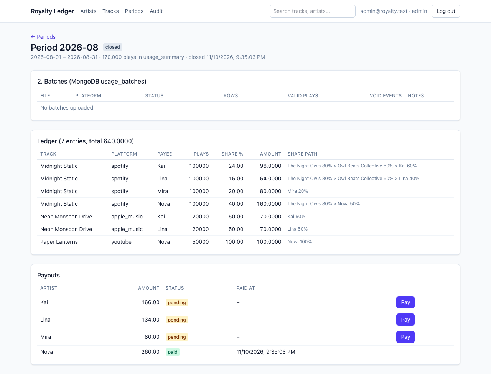
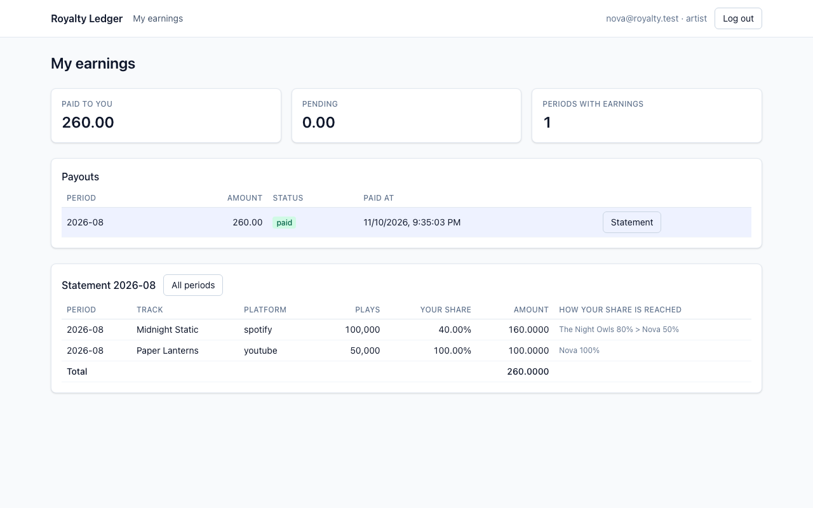

# Transparent Royalty Split & Payout Ledger: Project Report

DBMS Level 3 mini project, PES University (Aug–Dec 2026).
Team: Rohit Krishna R (Member A) · Shana Susan Varghese (Member B).

> Sections 1–8 are Member A's slice (WP10a). Sections 9–15 are Member B's slice (WP10b).

---------------------------------------------------------------------------------------------------

## 1. Objectives
Independent artists, producers and songwriters split a track's earnings through spreadsheets that drift
out of sync, cannot be audited, and routinely pay someone twice or not at all. The project builds a system where:

1. Every split agreement is provably complete: shares always total exactly 100%, enforced by the database.
2. Splits can be nested: a band's share is divided among its members, and a member may itself be a group.
3. Agreements are versioned; history is never overwritten, and each payout traces back to the version that priced it.
4. Platform usage (high volume, a different format per platform) is cleaned before it can turn into money.
5. Money is append-only: ledger lines are never edited or deleted, nobody is paid twice, closed periods are final.
6. Each role sees exactly what it should, enforced in the database as well as the app: artists their own
   earnings, auditors everything read-only, admins everything except rewriting history.

## 2. Requirements

### 2.1 Functional
| # | Requirement | Role | Where |
|---|---|---|---|
| F1 | Manage artists and groups; set group member shares (total 100%, groups inside groups, no cycles) | Admin | `/admin/artists`, `/api/artists/**` |
| F2 | Manage tracks: add a track from the artist's profile with its contributing artists and shares; full-text search over tracks and artists | Admin (search: all) | `/admin/artists/[id]`, `/admin/tracks`, `/api/artists/:id/tracks`, `/api/tracks/**`, `/api/search` |
| F3 | Versioned contracts: draft → active → superseded; edit splits only on a draft; activate only at 100% | Admin | `/admin/tracks/[id]`, `/api/contracts/**` |
| F4 | See the effective split of a track: who is really paid, through nested groups, and why | Admin, Auditor | `/api/tracks/:id/effective-split` |
| F5 | Upload platform usage reports; void duplicates and bot plays; dispute, resolve, purge | Admin | WP2 / WP7 (section 9) |
| F6 | Aggregate usage into PostgreSQL; close a period into ledger lines and payouts; mark payouts paid | Admin | WP5 / WP7 (section 10) |
| F7 | Artist statement and payouts | Artist | WP8 |
| F8 | Read-only ledger and audit trail | Auditor | WP8 (section 11) |
| F9 | Log in / out; role-based navigation; every route checks the role | All | WP1 (section 7) |

### 2.2 Non-functional
* **Integrity first:** every money and split rule is a constraint, trigger or function in PostgreSQL; the app calls them
  and shows their messages. Bypassing the app (e.g. `psql` as an app role) cannot break a rule.
* **Atomicity:** replacing a group's members, activating a contract and closing a period are each one transaction.
* **Least privilege:** the app switches to a NOLOGIN role per request; row-level security filters money rows.
* **Traceability:** a generic audit trigger records before/after JSON and the acting user.
* **Configuration:** all credentials come from `.env`; nothing is hard-coded; `.env` is never committed.
* **Reproducibility:** `scripts/db_reset.sh` rebuilds both databases with deterministic demo data.

## 3. ER diagram


The diagram source (Mermaid) is in `docs/DESIGN.md` section 4. Main relationships:

* `artist` 1–0..1 `app_user`: an artist may have a login; `app_user.artist_id` is set exactly when `role = 'artist'`.
* `artist` M–N `artist` through `group_member`: a group has members, a member can be in many groups; recursive.
* `track` 1–N `contract` 1–N `contract_split` N–1 `artist`: versioned agreements, one active and at most one draft per track.
* `payout_period` 1–N `usage_summary` N–1 `track`, `platform`: the plays loaded from MongoDB.
* `payout_period` 1–N `ledger_entry` N–1 `track`, `contract`, `artist`, `platform`: one line per payee per path.
* `payout_period` 1–N `payout` N–1 `artist`: at most one payout per artist per period.

## 4. Relational schema
Primary keys underlined, foreign keys marked with `*`. DDL: `sql/init/01_schema.sql`.

* artist(<u>artist_id</u>, name, kind, email, created_at, search_vector)
* app_user(<u>user_id</u>, email, password_hash, role, artist_id\*, created_at)
* group_member(<u>group_id\*</u>, <u>member_id\*</u>, share_pct)
* platform(<u>code</u>, name, rate_per_play)
* track(<u>track_id</u>, title, isrc, primary_artist_id\*, released_on, search_vector)
* contract(<u>contract_id</u>, track_id\*, version, status, activated_at, created_at)
* contract_split(<u>contract_id\*</u>, <u>artist_id\*</u>, share_pct)
* payout_period(<u>period_id</u>, label, starts_on, ends_on, status, closed_at)
* usage_summary(<u>period_id\*</u>, <u>track_id\*</u>, <u>platform_code\*</u>, plays)
* ledger_entry(<u>entry_id</u>, period_id\*, track_id\*, contract_id\*, artist_id\*, platform_code\*, plays, effective_pct, amount, share_path, created_at)
* payout(<u>payout_id</u>, period_id\*, artist_id\*, amount, status, paid_at)
* audit_log(<u>audit_id</u>, table_name, op, row_pk, before, after, actor, at)

**Normal form.** Every table is in BCNF: each non-trivial functional dependency has a (super)key on its left side.
`track.isrc`, `artist.name`, `payout_period.label` and `app_user.email` are alternate keys (UNIQUE).
`ledger_entry` deliberately copies `plays` and `effective_pct` at close time. That is not redundancy to normalise away:
the ledger is a historical record and must keep the values that produced each amount, even after a newer contract
version is activated (and closed-period usage cannot change anyway).

**Keys and constraints beyond PK/FK**

| Constraint | Kind | Purpose |
|---|---|---|
| `app_user_artist_role` | CHECK | `(role = 'artist') = (artist_id IS NOT NULL)` |
| `group_member_not_self`, share `> 0 AND <= 100` | CHECK | no self-membership, sane shares |
| `track.isrc` format | CHECK + UNIQUE | `^[A-Z]{2}[A-Z0-9]{3}[0-9]{7}$` |
| `uq_contract_one_active`, `uq_contract_one_draft` | partial UNIQUE index | one active / one draft contract per track |
| `contract_activated_at` | CHECK | `activated_at` set exactly when not a draft |
| `period_no_overlap` | EXCLUDE (gist) | payout periods never overlap |
| `period_dates`, `period_closed_at`, `payout_paid_at` | CHECK | consistent dates and status timestamps |
| `UNIQUE (period_id, artist_id)` on payout | UNIQUE | nobody is paid twice for a period |

## 5. Data dictionary
Generated from `information_schema` and `pg_constraint` by `scripts/data_dictionary.sh` on the seeded database
(regenerate after schema changes).

#### app_user

| Column | Type | Null | Default | Keys |
|---|---|---|---|---|
| user_id | integer | NOT NULL | identity | PK |
| email | varchar(255) | NOT NULL |  | UNIQUE |
| password_hash | text | NOT NULL |  |  |
| role | text | NOT NULL |  |  |
| artist_id | integer | null |  | FK -> artist, UNIQUE |
| created_at | timestamptz | NOT NULL | now() |  |

Checks: `CHECK (((role = 'artist'::text) = (artist_id IS NOT NULL)))`<br>`CHECK (((email)::text ~* '^[^@\s]+@[^@\s]+\.[^@\s]+$'::text))`<br>`CHECK ((role = ANY (ARRAY['admin'::text, 'artist'::text, 'auditor'::text])))`

#### artist

| Column | Type | Null | Default | Keys |
|---|---|---|---|---|
| artist_id | integer | NOT NULL | identity | PK |
| name | varchar(120) | NOT NULL |  | UNIQUE |
| kind | text | NOT NULL | 'solo' |  |
| email | varchar(255) | null |  | UNIQUE |
| created_at | timestamptz | NOT NULL | now() |  |
| search_vector | tsvector | null | generated |  |

Checks: `CHECK (((email)::text ~* '^[^@\s]+@[^@\s]+\.[^@\s]+$'::text))`<br>`CHECK ((kind = ANY (ARRAY['solo'::text, 'group'::text])))`

#### audit_log

| Column | Type | Null | Default | Keys |
|---|---|---|---|---|
| audit_id | bigint | NOT NULL | identity | PK |
| table_name | text | NOT NULL |  |  |
| op | text | NOT NULL |  |  |
| row_pk | text | NOT NULL |  |  |
| before | jsonb | null |  |  |
| after | jsonb | null |  |  |
| actor | text | NOT NULL |  |  |
| at | timestamptz | NOT NULL | now() |  |

Checks: `CHECK ((op = ANY (ARRAY['INSERT'::text, 'UPDATE'::text, 'DELETE'::text])))`

#### contract

| Column | Type | Null | Default | Keys |
|---|---|---|---|---|
| contract_id | integer | NOT NULL | identity | PK |
| track_id | integer | NOT NULL |  | FK -> track, UNIQUE (composite) |
| version | integer | NOT NULL |  | UNIQUE (composite) |
| status | text | NOT NULL | 'draft' |  |
| activated_at | timestamptz | null |  |  |
| created_at | timestamptz | NOT NULL | now() |  |

Checks: `CHECK (((status = 'draft'::text) = (activated_at IS NULL)))`<br>`CHECK ((status = ANY (ARRAY['draft'::text, 'active'::text, 'superseded'::text])))`<br>`CHECK ((version > 0))`

#### contract_split

| Column | Type | Null | Default | Keys |
|---|---|---|---|---|
| contract_id | integer | NOT NULL |  | FK -> contract, PK |
| artist_id | integer | NOT NULL |  | FK -> artist, PK |
| share_pct | numeric(5,2) | NOT NULL |  |  |

Checks: `CHECK (((share_pct > (0)::numeric) AND (share_pct <= (100)::numeric)))`

#### group_member

| Column | Type | Null | Default | Keys |
|---|---|---|---|---|
| group_id | integer | NOT NULL |  | FK -> artist, PK |
| member_id | integer | NOT NULL |  | FK -> artist, PK |
| share_pct | numeric(5,2) | NOT NULL |  |  |

Checks: `CHECK ((group_id <> member_id))`<br>`CHECK (((share_pct > (0)::numeric) AND (share_pct <= (100)::numeric)))`

#### ledger_entry

| Column | Type | Null | Default | Keys |
|---|---|---|---|---|
| entry_id | bigint | NOT NULL | identity | PK |
| period_id | integer | NOT NULL |  | FK -> payout_period, UNIQUE (composite) |
| track_id | integer | NOT NULL |  | FK -> track, UNIQUE (composite) |
| contract_id | integer | NOT NULL |  | FK -> contract |
| artist_id | integer | NOT NULL |  | FK -> artist, UNIQUE (composite) |
| platform_code | varchar(30) | NOT NULL |  | FK -> platform, UNIQUE (composite) |
| plays | bigint | NOT NULL |  |  |
| effective_pct | numeric(9,6) | NOT NULL |  |  |
| amount | numeric(14,4) | NOT NULL |  |  |
| share_path | text | NOT NULL |  | UNIQUE (composite) |
| created_at | timestamptz | NOT NULL | now() |  |

Checks: `CHECK ((amount >= (0)::numeric))`<br>`CHECK (((effective_pct > (0)::numeric) AND (effective_pct <= (100)::numeric)))`<br>`CHECK ((plays >= 0))`

#### payout

| Column | Type | Null | Default | Keys |
|---|---|---|---|---|
| payout_id | integer | NOT NULL | identity | PK |
| period_id | integer | NOT NULL |  | FK -> payout_period, UNIQUE (composite) |
| artist_id | integer | NOT NULL |  | FK -> artist, UNIQUE (composite) |
| amount | numeric(14,2) | NOT NULL |  |  |
| status | text | NOT NULL | 'pending' |  |
| paid_at | timestamptz | null |  |  |

Checks: `CHECK ((amount >= (0)::numeric))`<br>`CHECK (((status = 'paid'::text) = (paid_at IS NOT NULL)))`<br>`CHECK ((status = ANY (ARRAY['pending'::text, 'paid'::text])))`

#### payout_period

| Column | Type | Null | Default | Keys |
|---|---|---|---|---|
| period_id | integer | NOT NULL | identity | PK |
| label | varchar(40) | NOT NULL |  | UNIQUE |
| starts_on | date | NOT NULL |  |  |
| ends_on | date | NOT NULL |  |  |
| status | text | NOT NULL | 'open' |  |
| closed_at | timestamptz | null |  |  |

Checks: `CHECK ((status = ANY (ARRAY['open'::text, 'closed'::text])))`<br>`CHECK (((status = 'closed'::text) = (closed_at IS NOT NULL)))`<br>`CHECK ((ends_on > starts_on))`<br>`EXCLUDE USING gist (daterange(starts_on, ends_on, '[]'::text) WITH &&)`

#### platform

| Column | Type | Null | Default | Keys |
|---|---|---|---|---|
| code | varchar(30) | NOT NULL |  | PK |
| name | varchar(60) | NOT NULL |  |  |
| rate_per_play | numeric(10,6) | NOT NULL |  |  |

Checks: `CHECK (((code)::text ~ '^[a-z_]+$'::text))`<br>`CHECK ((rate_per_play > (0)::numeric))`

#### track

| Column | Type | Null | Default | Keys |
|---|---|---|---|---|
| track_id | integer | NOT NULL | identity | PK |
| title | varchar(200) | NOT NULL |  |  |
| isrc | char(12) | NOT NULL |  | UNIQUE |
| primary_artist_id | integer | NOT NULL |  | FK -> artist |
| released_on | date | null |  |  |
| search_vector | tsvector | null | generated |  |

Checks: `CHECK ((isrc ~ '^[A-Z]{2}[A-Z0-9]{3}[0-9]{7}$'::text))`

#### usage_summary

| Column | Type | Null | Default | Keys |
|---|---|---|---|---|
| period_id | integer | NOT NULL |  | FK -> payout_period, PK |
| track_id | integer | NOT NULL |  | FK -> track, PK |
| platform_code | varchar(30) | NOT NULL |  | FK -> platform, PK |
| plays | bigint | NOT NULL |  |  |

Checks: `CHECK ((plays >= 0))`

## 6. Catalogue and contracts

### 6.1 Database
* **Nested splits (recursive CTE).** `resolve_contract_split(contract_id)` starts from a contract's splits and joins
  `group_member` recursively, multiplying shares on the way down, and keeps only paths that end at a solo artist.
  Each row carries a readable path, e.g. `The Night Owls 70% > Owl Beats Collective 50% > Kai 60%` = 21%.
  `resolve_split(track_id)` applies it to the active contract and raises if the result is not exactly 100%.
* **Group rules.** `fn_group_member_guard` (BEFORE trigger) rejects members of non-groups and cycles (a recursive
  walk down from the new member). `trg_group_member_sum` is a `DEFERRABLE INITIALLY DEFERRED` constraint trigger:
  the 100% rule is checked at COMMIT, so the API can delete and re-insert a whole member set in one transaction.
* **Contract lifecycle.** `create_contract_draft` locks the track row, refuses a second draft, inserts version n+1 and
  copies the active splits. `fn_contract_split_draft_only` makes splits editable only on drafts.
  `activate_contract` locks the contract, requires exactly 100%, supersedes the old active version and activates the
  new one in one transaction. `fn_contract_guard` makes superseded contracts final and allows deleting drafts only.
* **Search.** Generated `tsvector` columns on `track.title` and `artist.name` with GIN indexes; `search_catalog(q)`
  builds a prefix query from the words of `q` (punctuation stripped, so input cannot break the query) and ranks results.
* **Views.** `v_active_split` (track → resolved payees) and `v_contract_overview` (versions with totals).

### 6.2 API and screens
`/api/artists`, `/api/artists/:id/{members,tracks}`, `/api/tracks`, `/api/tracks/:id/contracts`, `/api/contracts/:id/{splits,activate}`,
`/api/tracks/:id/{effective-split,history}`, `/api/search` (full contract: `docs/API_CONTRACT.md`).
Screens: `/admin/artists` (list), `/admin/artists/[id]` (artist profile: group member editor, the artist's tracks, and
"Add a track" with contributing artists; the track, its version-1 draft and the splits are written in one transaction,
optionally activated there too), `/admin/tracks`, `/admin/tracks/[id]` (versions, draft editor,
effective split, history).

The share editor shows a live total (computed in cents, so 33.33 + 33.33 + 33.34 is exactly 100) but does not block
saving. The database decides, and its message reaches the user unchanged:






## 7. Authentication, roles and row-level security
* **Login.** `POST /api/auth/login` looks the e-mail up as the owner role (the only query that may read `app_user`),
  checks the bcrypt hash (`pgcrypto` `crypt(..., gen_salt('bf'))` in the seed, `bcryptjs` in the app), and sets an
  httpOnly, `SameSite=Lax` cookie holding an HS256 JWT (`jose`, secret `AUTH_SECRET`, 8 hours). Unknown e-mail and
  wrong password take the same time and give the same message.
* **Two layers of authorisation.**
  1. App: `route(roles, handler)` returns 401/403 before any query; `proxy.ts` guards pages (`/admin` admin,
     `/me` artist, `/audit` auditor or admin).
  2. Database: `withDb()` runs every request as `BEGIN; SET LOCAL ROLE rl_<role>; set_config('app.user_id', …, true);`
     (and `app.artist_id` for artists). The role name comes from a whitelist, never from input.
* **Database roles** (`sql/init/03_roles.sql`):

| Role | Can | Cannot |
|---|---|---|
| `rl_admin` | read/write catalogue, contracts, periods, usage, payouts; insert ledger/audit | UPDATE/DELETE `ledger_entry`, `audit_log`; read `app_user` |
| `rl_auditor` | SELECT everything except `app_user` | any write |
| `rl_artist` | SELECT catalogue names, periods; own `ledger_entry` / `payout` rows only | anything else |

* **Row-level security** on `ledger_entry` and `payout`: `artist_id = current_setting('app.artist_id')::int` for
  `rl_artist`. Views use `security_invoker = true`, so `v_artist_statement` obeys the same policy.
* **Audit actor.** `fn_audit` is `SECURITY DEFINER`, so it can translate `app.user_id` into the user's e-mail even
  though app roles cannot read `app_user`.
* **Errors.** `lib/http.ts` maps SQLSTATE to HTTP: `P0001` (RAISE) 409, `23505`/`23503`/`23P01` 409, `23514` 400,
  `42501` 403; zod failures 400.

Tests: `sql/tests/test_logic.sql` T16–T18 (RLS isolation, auditor/admin limits, audit actor) and
`tests/api/auth.test.ts` (login, 401, 403 per role, the page guard, `withDb` running as `rl_artist`).

## 8. Architecture
```
Browser ── Next.js pages (/admin/*, /me, /audit)   ── client components call the JSON API
   │
   ├─ proxy.ts: session cookie → page guard per role
   │
Next.js Route Handlers (app/api/**)  ── route(roles) → zod → withDb / mongoDb
   │                                      │
   │  pg Pool ── BEGIN; SET LOCAL ROLE rl_*; app.user_id / app.artist_id ── PostgreSQL 16
   │                                         (constraints, triggers, functions, procedure, views, RLS)
   │
   └─ mongodb driver ─────────────────────────────────────────────────────── MongoDB 7 (royalty_events)
                                              usage_batches, usage_events ($jsonSchema, aggregation)
```
* **Boundary between the stores:** MongoDB's `aggregateUsage(periodId)` returns `[{track_id, platform, plays}]`; the
  aggregate route validates every id against PostgreSQL and replaces the period's `usage_summary` rows in one transaction.
* **Repository layout:** `sql/` (DDL, logic, roles, seed, tests, demos) · `mongo/` (init, pipelines, seed, tests) ·
  `app/` (pages and route handlers) · `lib/` (db, session, http, catalogue and contract queries) · `components/` ·
  `tests/` (Vitest API tests on a scratch database) · `scripts/` (reset, tests, data dictionary, screenshots).
* **Stack:** Next.js 16 (App Router, TypeScript), Tailwind 4, `pg` (no ORM), `mongodb`, `bcryptjs`, `jose`, `zod`, Vitest,
  Playwright (screenshots), Docker Compose for PostgreSQL 16 and MongoDB 7.

---------------------------------------------------------------------------------------------------

## 9. MongoDB: usage ingestion and cleaning

### 9.1 Why a document store here
Each platform sends a different report: Spotify adds `playlist`, `premium`, `shuffle`; YouTube adds `watch_seconds`,
`ad_supported`, `surface`; Apple Music adds `storefront`, `lossless`, `library_add`. Reports are large, written once,
then cleaned (voided, disputed, purged) and summarised. MongoDB keeps each event as one document with the common fields
validated and the platform-specific fields in `raw`, untouched. Aggregation pipelines do the cleaning and the summary.
Money never lives in MongoDB: only the summary `{ track_id, platform, plays }` crosses into PostgreSQL (section 10).

### 9.2 Collections (`mongo/init/01_init.js`)
| Collection | Holds | Validator (`$jsonSchema`, strict) | Indexes |
|---|---|---|---|
| `usage_batches` | one uploaded report: `period_id`, `platform`, `source_file`, `uploaded_by`, `uploaded_at`, `row_count`, `status`, `notes[]` | required fields, `status` in `uploaded / cleaned / disputed / aggregated`, note kinds, no extra fields | `{period_id, status}` |
| `usage_events` | one play line: `batch_id`, `period_id`, `track_id`, `platform`, `plays`, `listener_hash`, `played_at`, `device`, `status`, `void_reason`, `raw` | ints for ids and plays (`plays >= 1`), `status` `valid / void`, `void_reason` `duplicate / bot / manual`, `raw` is an object | `{period_id, status}`, `{batch_id}`, `{track_id, platform, listener_hash, played_at}` |

The batch `notes[]` array is the batch's history: every clean, dispute, resolve, purge and aggregate step `$push`es
`{ at, by, kind, text }`, so the review trail stays inside the document it describes.

### 9.3 Operations (`mongo/pipelines/usage_ops.js`, API in `app/api/periods/[id]/usage/*`, `app/api/usage/batches/*`)
| Kind | Operation | Route | How |
|---|---|---|---|
| Create | `ingest` | `POST /api/periods/:id/usage/import` | `insertOne` batch + `insertMany` events; compensating delete if the events fail (no replica set, so no multi-document transaction) |
| Read | `listBatches`, `batchStats` | `GET /api/usage/batches?period_id=` | `find` + `$group` by batch and status |
| Read | `findDuplicates` | `GET /api/periods/:id/usage/duplicates` | `$group` on track, platform, listener, timestamp; groups with `n > 1`; first-inserted copy is kept |
| Read | `findFlagged` | `GET /api/periods/:id/usage/flagged` | `$group` by listener and `$dateTrunc` hour; more than `max_per_hour` (default 20) plays |
| Update | `voidDuplicates`, `voidFlagged` | `POST .../void-duplicates`, `.../void-flagged` | `updateMany` `$set: { status: 'void', void_reason }`; batch becomes `cleaned` |
| Update | `disputeBatch`, `resolveDispute` | `POST /api/usage/batches/:id/dispute`, `.../resolve` | `updateOne` with the rule in the filter (`status != 'aggregated'` / `status = 'disputed'`), `$set` + `$push` note; atomic check-and-write |
| Delete | `purgeVoided` | `DELETE /api/periods/:id/usage/voided` | `deleteMany` voided events |
| Read | `aggregateUsage` | `POST /api/periods/:id/aggregate` | valid events of non-disputed batches, `$group` per track and platform |

**Import validation (`lib/usage.ts`).** CSV (header row, any column order, quoted fields) or JSON. Every row is checked
with zod (`track_id` and `plays` whole numbers, `listener_hash` present, `played_at` an ISO timestamp inside the period);
`platform` and every `track_id` are checked against PostgreSQL. Problems are collected per row; if there is any, the whole
upload is refused with 1-based row numbers and nothing is stored:
```
400 { "error": "2 invalid rows", "details": [
  { "row": 2, "message": "plays: must be >= 1" },
  { "row": 3, "message": "played_at: 2026-10-02T10:00:00Z is outside period 2026-09; track_id: track 99 does not exist" } ] }
```
**Closed periods.** MongoDB has no triggers or foreign keys to PostgreSQL, so every usage write first reads the period
status from PostgreSQL (`requireOpenPeriod`) and refuses with `409 Period 2026-08 is closed`.

### 9.4 Real output (`scripts/run_mongo_queries.sh` -> `mongo/demo/usage_queries_output.txt`)
The script builds a scratch database from `mongo/init` and the deterministic seed (5,000 events in 4 batches, with a resent
Spotify report, in-file YouTube duplicates and one bot listener), runs `mongo/demo/usage_queries.js` and drops it.
| Step | Result |
|---|---|
| R2 query inside `raw`: YouTube plays watched under 60 s | 171 events |
| R3 events per batch (`$group` + `$lookup`) | apple_music 1200, spotify 2250, spotify resend 120, youtube 1430 |
| R4 duplicates | 150 groups, 150 extra rows |
| R5 bot heuristic | `lh_bot_7f3a`, Spotify, 2026-09-12 14:00 UTC, 150 plays in one hour |
| U1 / U2 void duplicates / bots (`updateMany`) | 150 + 150 modified |
| U3 dispute the resend (`updateOne`, `$set` + `$push`) | status `disputed`, note in `notes[]` |
| D1 purge voided (`deleteMany`) | 300 deleted (4,700 valid events remain) |
| R6 `aggregateUsage` (resend excluded while disputed) | `{ track_id: 1, platform: 'apple_music', plays: 364 }`, … |
| Validator | event without `listener_hash` -> `Document failed validation (121)` |

## 10. Payouts: aggregate, close, pay

### 10.1 Aggregate: MongoDB -> `usage_summary` (`lib/payouts.ts`)
`POST /api/periods/:id/aggregate` (`preview: true` only shows the rows):
1. 409 if the period is closed, or if any batch is `disputed` (`Period 2026-10 has disputed batches (spotify.json); resolve them first`).
2. `aggregateUsage` returns `[{ track_id, platform, plays }]`. Every `track_id` must exist in `track` and every
   `platform` in `platform.code`; otherwise 400 listing the unknown values, nothing written.
3. One PostgreSQL transaction: `SELECT ... FROM payout_period ... FOR UPDATE` (the same row lock `close_payout_period`
   takes, so the two cannot interleave), `DELETE` the period's `usage_summary`, `INSERT ... SELECT FROM unnest(...)` the new
   rows. `trg_usage_period_open` still guards the table against closed periods.
4. After the commit the batches are marked `aggregated`. If that step failed, aggregating again rewrites the same
   summary, so nothing is ever counted twice.

### 10.2 Close (`close_payout_period`, `02_logic.sql`)
`POST /api/periods/:id/close` only runs `CALL close_payout_period($1)`. In one transaction the procedure locks the period,
refuses a closed or empty period and any track without an active contract, writes one `ledger_entry` per usage row and
payee (`plays × rate_per_play × effective_pct / 100`, rounded to 4 places, with the `share_path`), sums them per artist
into `payout` (2 places) and marks the period closed. Its messages are returned unchanged with status 409:
`Period 2026-08 is already closed`, `Period 2026-12 has no usage loaded; aggregate usage first`,
`Cannot close period 2026-11: no active contract for Unfinished Demo`.

Worked example (end-to-end test, period 2029-01, contract Kai 60 / Lina 40):
| Platform | Plays | Rate | Gross | Kai 60% | Lina 40% |
|---|---|---|---|---|---|
| spotify | 1,000 (after voiding one duplicate) | 0.004 | 4.00 | 2.40 | 1.60 |
| youtube | 1,000 | 0.002 | 2.00 | 1.20 | 0.80 |
| **payout** | | | 6.00 | **3.60** | **2.40** |

### 10.3 Ledger and payouts
* `GET /api/periods/:id/ledger?artist_id=&track_id=` (admin, auditor): ledger lines with track, payee, plays, effective
  share, amount and share path. The application has no code that updates or deletes `ledger_entry`, and
  `fn_ledger_append_only` would refuse it anyway.
* `GET /api/payouts?period_id=` (all roles). For an artist the same query returns only their rows, because of the RLS policy
  `payout_artist`.
* `POST /api/payouts/:id/pay` runs `mark_payout_paid`, which locks the payout row (`SELECT ... FOR UPDATE`) and raises if it
  is already paid. Two simultaneous requests therefore produce one 200 and one `409 Payout 5 is already paid`.
  `tests/api/payouts.test.ts` sends them with `Promise.all`.



## 11. Audit trail and auditor view
`fn_audit` (a generic trigger on `contract`, `contract_split`, `group_member`, `payout`, `payout_period`) writes one
`audit_log` row per change: table, operation, primary key, `before` and `after` as JSONB (`to_jsonb(OLD/NEW)`), the actor
(the `app_user` email found from `app.user_id`, which `withDb` sets; the database role for the seed script) and the time.
* `GET /api/audit` (auditor, admin): filters `table` (a whitelist, `z.enum`), `row_pk`, `actor` (partial match), `from` /
  `to` (dates, `to` inclusive) and `limit` (1–500, default 100). All of them are query parameters (`$1`…`$6`).
* `/audit` shows the trail with the changed keys per row and the full before/after JSON on click. A read-only
  "Ledger & payouts" tab shows any period's ledger and payouts. `rl_auditor` has SELECT only, so the page has no write
  actions, and the database would refuse them.
* `/me` (artists): payouts and the statement per period from `v_artist_statement`. The view is `security_invoker`, so
  `ledger_artist` applies and the query needs no `WHERE artist_id`. Nova sees her two August lines (160.0000 through
  `The Night Owls 80% > Nova 50%` and 100.0000 for Paper Lanterns), which add up to her 260.00 payout. Mira's page shows
  none of them.



## 12. Important queries
`sql/demo/queries.sql`; real output from a fresh seeded database in `sql/demo/queries_output.txt`
(`scripts/run_queries.sh`).

| # | Concept | Query | Result on the seed |
|---|---|---|---|
| Q1 | 4-table JOIN | Kai's statement lines | 2 rows, e.g. Midnight Static, Spotify, 100000 plays, 24%, 96.0000, `The Night Owls 80% > Owl Beats Collective 50% > Kai 60%` |
| Q2 | GROUP BY + HAVING | artists who earned more than 100 in 2026-08 | Nova 260.0000, Kai 166.0000, Lina 134.0000 (Mira's 80 is filtered out) |
| Q3 | Recursive CTE | expand contract 9 through nested groups | Nova 35.00 (depth 1), Mira 30.00, Kai 21.00 and Lina 14.00 (depth 2) = 100 |
| Q4 | Correlated subquery | each artist's top-earning track | Kai: Midnight Static 96.0000, Lina: Neon Monsoon Drive 70.0000, Mira 80.0000, Nova 160.0000 |
| Q5 | Nested `IN` / `NOT EXISTS` | tracks with usage but no active contract | 0 rows (the check `close_payout_period` relies on) |
| Q6 | Window functions | share of the period and rank | Nova 40.63% rank 1 … Mira 12.50% rank 4 |
| Q7 | HAVING + scalar subqueries | ledger = plays × rate for every closed period | 0 rows: the books balance |
| Q8 | JSONB | audit history of contract 1 | INSERT draft -> UPDATE active -> UPDATE superseded |
| Q9 | Full-text search, views | `search_catalog('night owls')`, `v_active_split`, `v_period_totals` | The Night Owls (rank 0.099); 17 resolved payee rows; period totals |
| Q10 | Index use | `EXPLAIN` on the ledger lookup | `Index Scan using idx_ledger_artist_period` |
| Q11 | DML | INSERT / UPDATE / DELETE … RETURNING | artist 7 created, renamed, deleted |
| Q12 | Rules in the database | six forbidden changes | all refused, see below |

Q12 output (verbatim):
```
UPDATE ledger_entry ...            ERROR:  ledger_entry is append-only: UPDATE is not allowed
INSERT INTO usage_summary (2,...)  ERROR:  Usage of closed period 2026-08 cannot be changed
SELECT mark_payout_paid(1)         ERROR:  Payout 1 is already paid
UPDATE contract_split (contract 9) ERROR:  Contract 9 is active; splits can only be edited on a draft
UPDATE group_member -> 59 + 40     ERROR:  Member shares of group 6 total 99 percent, must be exactly 100
INSERT overlapping payout_period   ERROR:  conflicting key value violates exclusion constraint "period_no_overlap"
```

## 13. Testing results
Run on 2026-11-17 against the docker-compose PostgreSQL 16 and MongoDB 7. API tests call the real route handlers. Each run
builds its own scratch PostgreSQL database from `sql/init` and a scratch MongoDB database from `mongo/init`, and drops both
afterwards, so dev data is never touched.

**`npm test`: 9 files, 137 tests, all passing** (also with `--sequence.shuffle.files`):
| File | Tests | Covers |
|---|---|---|
| `tests/api/auth.test.ts` | 11 | login, session cookie, 401 / 403, page guard, `withDb` role switch and rollback |
| `tests/api/catalogue.test.ts` | 9 | artists, group members (99%, cycles), tracks, search |
| `tests/api/contracts.test.ts` | 13 | draft, splits, activate (90% refused), delete, effective split, history |
| `tests/api/usage.test.ts` | 20 | periods, CSV and JSON import, row errors, duplicates, bots, purge, dispute, resolve, closed period |
| `tests/api/payouts.test.ts` | 14 | aggregate (preview, disputed, unknown ids, replace), close, ledger, RLS on payouts, pay, **concurrent pay** |
| `tests/api/me-audit.test.ts` | 6 | artist statement and payouts (artist A cannot see artist B), audit filters |
| `tests/api/e2e.test.ts` | 8 | full money flow: track -> contract -> upload -> clean -> aggregate -> close -> pay -> artist view -> audit |
| `tests/api/sweep.test.ts` | 46 | one success and one failure for each of the 45 route methods, plus a guard test |
| `mongo/tests/usage_ops.test.js` | 10 | validators, ingest, duplicates, bots, dispute, purge, aggregation shape |

**`scripts/test_db.sh`: 20 SQL test groups, `ALL TESTS PASSED`.** These cover nested splits, group totals (deferred),
cycles, draft-only edits, 90% activation, one active contract, constraints, the append-only ledger, closed-period
immutability, double close, a missing contract, close end to end, pay once, RLS isolation, auditor read-only, the audit
trail, search and views.

Also checked: `npx tsc --noEmit` and `npx next build` are clean, and the screens were driven in headless Chromium
(Playwright) against `next start`.

## 14. Screenshots
All in `docs/screenshots/`, taken with headless Chromium against the seeded data.

| Screen | File |
|---|---|
| Periods list | `7-periods.png` |
| Overlapping period refused by PostgreSQL | `7-periods-overlap-error.png` |
| Upload rejected with row numbers | `7-upload-rejected.png` |
| Batches, duplicate and bot previews, aggregate preview | `7-period-cleaning.png` |
| Disputed batch blocks aggregation | `7-batch-disputed.png` |
| Closed period: ledger with share paths, payouts with Pay | `7-period-closed-ledger.png` |
| Artist view (Nova / Mira) | `8-me-nova.png`, `8-me-mira.png` |
| Auditor: audit trail with before/after | `8-audit-trail.png` |
| Auditor: read-only ledger and payouts | `8-audit-ledger.png` |







## 15. Conclusion
The system replaces spreadsheet splits with versioned contracts and an append-only ledger. Each part runs on the database
that suits it. PostgreSQL holds everything that is money or ownership, and its rules are in the database itself: exact
100% splits checked at commit, frozen contracts and closed periods, a ledger that cannot be edited, payouts that cannot be
paid twice, and row-level security so that an artist's queries only ever return their own rows. MongoDB takes the noisy,
platform-specific usage reports and cleans them with aggregation pipelines. Only a small, validated
`{ track_id, platform, plays }` summary reaches the money side.

What we would add next: a replica set so that a MongoDB upload and its cleaning steps can run in multi-document
transactions; streaming CSV parsing for very large reports; currency and per-territory rates on `platform`; and payout
export files for the bank.
