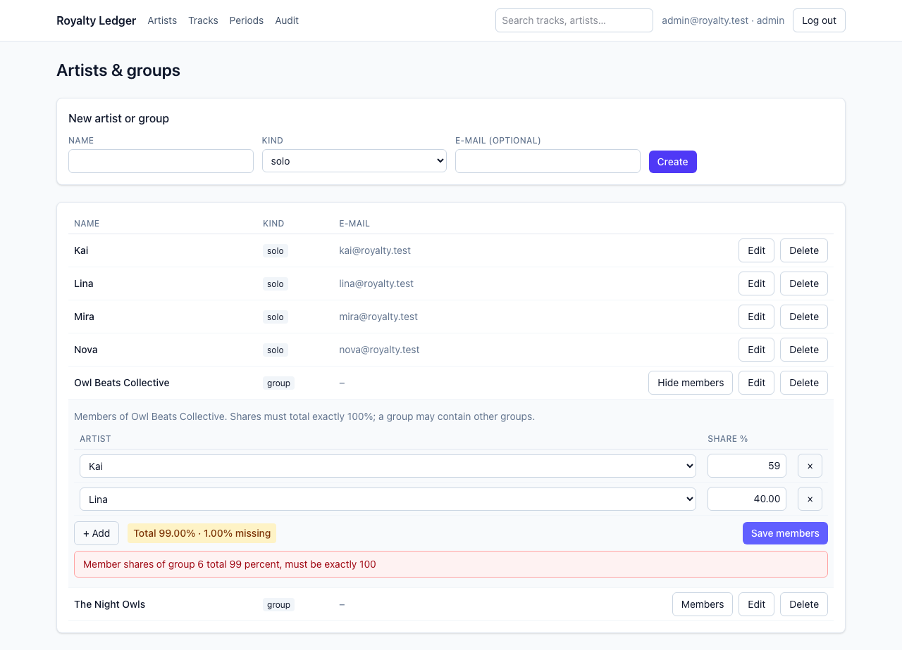

# Transparent Royalty Split & Payout Ledger: Project Report

DBMS Level 3 mini project, PES University (Aug–Dec 2026).
Team: Rohit Krishna R (Member A) · Shana Susan Varghese (Member B).

> Sections 1–8 are Member A's slice (WP10a). Sections 9–15 are Member B's slice (WP10b).

---------------------------------------------------------------------------------------------------

## 1. Objectives
Independent artists, producers and songwriters split a track's earnings through spreadsheets that drift
out of sync, cannot be audited, and routinely pay someone twice or not at all. The project builds a system where:

1. Every split agreement is provably complete: shares always total exactly 100%, enforced by the database.
2. Splits can be nested: a band's share is divided among its members, and a member may itself be a group.
3. Agreements are versioned; history is never overwritten, and each payout traces back to the version that priced it.
4. Platform usage (high volume, a different format per platform) is cleaned before it can turn into money.
5. Money is append-only: ledger lines are never edited or deleted, nobody is paid twice, closed periods are final.
6. Each role sees exactly what it should, enforced in the database as well as the app: artists their own
   earnings, auditors everything read-only, admins everything except rewriting history.

## 2. Requirements

### 2.1 Functional
| # | Requirement | Role | Where |
|---|---|---|---|
| F1 | Manage artists and groups; set group member shares (total 100%, groups inside groups, no cycles) | Admin | `/admin/artists`, `/api/artists/**` |
| F2 | Manage tracks; full-text search over tracks and artists | Admin (search: all) | `/admin/tracks`, `/api/tracks/**`, `/api/search` |
| F3 | Versioned contracts: draft → active → superseded; edit splits only on a draft; activate only at 100% | Admin | `/admin/tracks/[id]`, `/api/contracts/**` |
| F4 | See the effective split of a track: who is really paid, through nested groups, and why | Admin, Auditor | `/api/tracks/:id/effective-split` |
| F5 | Upload platform usage reports; void duplicates and bot plays; dispute, resolve, purge | Admin | WP2 / WP7 (section 9) |
| F6 | Aggregate usage into PostgreSQL; close a period into ledger lines and payouts; mark payouts paid | Admin | WP5 / WP7 (section 10) |
| F7 | Artist statement and payouts | Artist | WP8 |
| F8 | Read-only ledger and audit trail | Auditor | WP8 (section 11) |
| F9 | Log in / out; role-based navigation; every route checks the role | All | WP1 (section 7) |

### 2.2 Non-functional
* **Integrity first:** every money and split rule is a constraint, trigger or function in PostgreSQL; the app calls them
  and shows their messages. Bypassing the app (e.g. `psql` as an app role) cannot break a rule.
* **Atomicity:** replacing a group's members, activating a contract and closing a period are each one transaction.
* **Least privilege:** the app switches to a NOLOGIN role per request; row-level security filters money rows.
* **Traceability:** a generic audit trigger records before/after JSON and the acting user.
* **Configuration:** all credentials come from `.env`; nothing is hard-coded; `.env` is never committed.
* **Reproducibility:** `scripts/db_reset.sh` rebuilds both databases with deterministic demo data.

## 3. ER diagram


The diagram source (Mermaid) is in `docs/DESIGN.md` section 4. Main relationships:

* `artist` 1–0..1 `app_user`: an artist may have a login; `app_user.artist_id` is set exactly when `role = 'artist'`.
* `artist` M–N `artist` through `group_member`: a group has members, a member can be in many groups; recursive.
* `track` 1–N `contract` 1–N `contract_split` N–1 `artist`: versioned agreements, one active and at most one draft per track.
* `payout_period` 1–N `usage_summary` N–1 `track`, `platform`: the plays loaded from MongoDB.
* `payout_period` 1–N `ledger_entry` N–1 `track`, `contract`, `artist`, `platform`: one line per payee per path.
* `payout_period` 1–N `payout` N–1 `artist`: at most one payout per artist per period.

## 4. Relational schema
Primary keys underlined, foreign keys marked with `*`. DDL: `sql/init/01_schema.sql`.

* artist(<u>artist_id</u>, name, kind, email, created_at, search_vector)
* app_user(<u>user_id</u>, email, password_hash, role, artist_id\*, created_at)
* group_member(<u>group_id\*</u>, <u>member_id\*</u>, share_pct)
* platform(<u>code</u>, name, rate_per_play)
* track(<u>track_id</u>, title, isrc, primary_artist_id\*, released_on, search_vector)
* contract(<u>contract_id</u>, track_id\*, version, status, activated_at, created_at)
* contract_split(<u>contract_id\*</u>, <u>artist_id\*</u>, share_pct)
* payout_period(<u>period_id</u>, label, starts_on, ends_on, status, closed_at)
* usage_summary(<u>period_id\*</u>, <u>track_id\*</u>, <u>platform_code\*</u>, plays)
* ledger_entry(<u>entry_id</u>, period_id\*, track_id\*, contract_id\*, artist_id\*, platform_code\*, plays, effective_pct, amount, share_path, created_at)
* payout(<u>payout_id</u>, period_id\*, artist_id\*, amount, status, paid_at)
* audit_log(<u>audit_id</u>, table_name, op, row_pk, before, after, actor, at)

**Normal form.** Every table is in BCNF: each non-trivial functional dependency has a (super)key on its left side.
`track.isrc`, `artist.name`, `payout_period.label` and `app_user.email` are alternate keys (UNIQUE).
`ledger_entry` deliberately copies `plays` and `effective_pct` at close time. That is not redundancy to normalise away:
the ledger is a historical record and must keep the values that produced each amount, even after a newer contract
version is activated (and closed-period usage cannot change anyway).

**Keys and constraints beyond PK/FK**

| Constraint | Kind | Purpose |
|---|---|---|
| `app_user_artist_role` | CHECK | `(role = 'artist') = (artist_id IS NOT NULL)` |
| `group_member_not_self`, share `> 0 AND <= 100` | CHECK | no self-membership, sane shares |
| `track.isrc` format | CHECK + UNIQUE | `^[A-Z]{2}[A-Z0-9]{3}[0-9]{7}$` |
| `uq_contract_one_active`, `uq_contract_one_draft` | partial UNIQUE index | one active / one draft contract per track |
| `contract_activated_at` | CHECK | `activated_at` set exactly when not a draft |
| `period_no_overlap` | EXCLUDE (gist) | payout periods never overlap |
| `period_dates`, `period_closed_at`, `payout_paid_at` | CHECK | consistent dates and status timestamps |
| `UNIQUE (period_id, artist_id)` on payout | UNIQUE | nobody is paid twice for a period |

## 5. Data dictionary
Generated from `information_schema` and `pg_constraint` by `scripts/data_dictionary.sh` on the seeded database
(regenerate after schema changes).

#### app_user

| Column | Type | Null | Default | Keys |
|---|---|---|---|---|
| user_id | integer | NOT NULL | identity | PK |
| email | varchar(255) | NOT NULL |  | UNIQUE |
| password_hash | text | NOT NULL |  |  |
| role | text | NOT NULL |  |  |
| artist_id | integer | null |  | FK -> artist, UNIQUE |
| created_at | timestamptz | NOT NULL | now() |  |

Checks: `CHECK (((role = 'artist'::text) = (artist_id IS NOT NULL)))`<br>`CHECK (((email)::text ~* '^[^@\s]+@[^@\s]+\.[^@\s]+$'::text))`<br>`CHECK ((role = ANY (ARRAY['admin'::text, 'artist'::text, 'auditor'::text])))`

#### artist

| Column | Type | Null | Default | Keys |
|---|---|---|---|---|
| artist_id | integer | NOT NULL | identity | PK |
| name | varchar(120) | NOT NULL |  | UNIQUE |
| kind | text | NOT NULL | 'solo' |  |
| email | varchar(255) | null |  | UNIQUE |
| created_at | timestamptz | NOT NULL | now() |  |
| search_vector | tsvector | null | generated |  |

Checks: `CHECK (((email)::text ~* '^[^@\s]+@[^@\s]+\.[^@\s]+$'::text))`<br>`CHECK ((kind = ANY (ARRAY['solo'::text, 'group'::text])))`

#### audit_log

| Column | Type | Null | Default | Keys |
|---|---|---|---|---|
| audit_id | bigint | NOT NULL | identity | PK |
| table_name | text | NOT NULL |  |  |
| op | text | NOT NULL |  |  |
| row_pk | text | NOT NULL |  |  |
| before | jsonb | null |  |  |
| after | jsonb | null |  |  |
| actor | text | NOT NULL |  |  |
| at | timestamptz | NOT NULL | now() |  |

Checks: `CHECK ((op = ANY (ARRAY['INSERT'::text, 'UPDATE'::text, 'DELETE'::text])))`

#### contract

| Column | Type | Null | Default | Keys |
|---|---|---|---|---|
| contract_id | integer | NOT NULL | identity | PK |
| track_id | integer | NOT NULL |  | FK -> track, UNIQUE (composite) |
| version | integer | NOT NULL |  | UNIQUE (composite) |
| status | text | NOT NULL | 'draft' |  |
| activated_at | timestamptz | null |  |  |
| created_at | timestamptz | NOT NULL | now() |  |

Checks: `CHECK (((status = 'draft'::text) = (activated_at IS NULL)))`<br>`CHECK ((status = ANY (ARRAY['draft'::text, 'active'::text, 'superseded'::text])))`<br>`CHECK ((version > 0))`

#### contract_split

| Column | Type | Null | Default | Keys |
|---|---|---|---|---|
| contract_id | integer | NOT NULL |  | FK -> contract, PK |
| artist_id | integer | NOT NULL |  | FK -> artist, PK |
| share_pct | numeric(5,2) | NOT NULL |  |  |

Checks: `CHECK (((share_pct > (0)::numeric) AND (share_pct <= (100)::numeric)))`

#### group_member

| Column | Type | Null | Default | Keys |
|---|---|---|---|---|
| group_id | integer | NOT NULL |  | FK -> artist, PK |
| member_id | integer | NOT NULL |  | FK -> artist, PK |
| share_pct | numeric(5,2) | NOT NULL |  |  |

Checks: `CHECK ((group_id <> member_id))`<br>`CHECK (((share_pct > (0)::numeric) AND (share_pct <= (100)::numeric)))`

#### ledger_entry

| Column | Type | Null | Default | Keys |
|---|---|---|---|---|
| entry_id | bigint | NOT NULL | identity | PK |
| period_id | integer | NOT NULL |  | FK -> payout_period, UNIQUE (composite) |
| track_id | integer | NOT NULL |  | FK -> track, UNIQUE (composite) |
| contract_id | integer | NOT NULL |  | FK -> contract |
| artist_id | integer | NOT NULL |  | FK -> artist, UNIQUE (composite) |
| platform_code | varchar(30) | NOT NULL |  | FK -> platform, UNIQUE (composite) |
| plays | bigint | NOT NULL |  |  |
| effective_pct | numeric(9,6) | NOT NULL |  |  |
| amount | numeric(14,4) | NOT NULL |  |  |
| share_path | text | NOT NULL |  | UNIQUE (composite) |
| created_at | timestamptz | NOT NULL | now() |  |

Checks: `CHECK ((amount >= (0)::numeric))`<br>`CHECK (((effective_pct > (0)::numeric) AND (effective_pct <= (100)::numeric)))`<br>`CHECK ((plays >= 0))`

#### payout

| Column | Type | Null | Default | Keys |
|---|---|---|---|---|
| payout_id | integer | NOT NULL | identity | PK |
| period_id | integer | NOT NULL |  | FK -> payout_period, UNIQUE (composite) |
| artist_id | integer | NOT NULL |  | FK -> artist, UNIQUE (composite) |
| amount | numeric(14,2) | NOT NULL |  |  |
| status | text | NOT NULL | 'pending' |  |
| paid_at | timestamptz | null |  |  |

Checks: `CHECK ((amount >= (0)::numeric))`<br>`CHECK (((status = 'paid'::text) = (paid_at IS NOT NULL)))`<br>`CHECK ((status = ANY (ARRAY['pending'::text, 'paid'::text])))`

#### payout_period

| Column | Type | Null | Default | Keys |
|---|---|---|---|---|
| period_id | integer | NOT NULL | identity | PK |
| label | varchar(40) | NOT NULL |  | UNIQUE |
| starts_on | date | NOT NULL |  |  |
| ends_on | date | NOT NULL |  |  |
| status | text | NOT NULL | 'open' |  |
| closed_at | timestamptz | null |  |  |

Checks: `CHECK ((status = ANY (ARRAY['open'::text, 'closed'::text])))`<br>`CHECK (((status = 'closed'::text) = (closed_at IS NOT NULL)))`<br>`CHECK ((ends_on > starts_on))`<br>`EXCLUDE USING gist (daterange(starts_on, ends_on, '[]'::text) WITH &&)`

#### platform

| Column | Type | Null | Default | Keys |
|---|---|---|---|---|
| code | varchar(30) | NOT NULL |  | PK |
| name | varchar(60) | NOT NULL |  |  |
| rate_per_play | numeric(10,6) | NOT NULL |  |  |

Checks: `CHECK (((code)::text ~ '^[a-z_]+$'::text))`<br>`CHECK ((rate_per_play > (0)::numeric))`

#### track

| Column | Type | Null | Default | Keys |
|---|---|---|---|---|
| track_id | integer | NOT NULL | identity | PK |
| title | varchar(200) | NOT NULL |  |  |
| isrc | char(12) | NOT NULL |  | UNIQUE |
| primary_artist_id | integer | NOT NULL |  | FK -> artist |
| released_on | date | null |  |  |
| search_vector | tsvector | null | generated |  |

Checks: `CHECK ((isrc ~ '^[A-Z]{2}[A-Z0-9]{3}[0-9]{7}$'::text))`

#### usage_summary

| Column | Type | Null | Default | Keys |
|---|---|---|---|---|
| period_id | integer | NOT NULL |  | FK -> payout_period, PK |
| track_id | integer | NOT NULL |  | FK -> track, PK |
| platform_code | varchar(30) | NOT NULL |  | FK -> platform, PK |
| plays | bigint | NOT NULL |  |  |

Checks: `CHECK ((plays >= 0))`

## 6. Catalogue and contracts

### 6.1 Database
* **Nested splits (recursive CTE).** `resolve_contract_split(contract_id)` starts from a contract's splits and joins
  `group_member` recursively, multiplying shares on the way down, and keeps only paths that end at a solo artist.
  Each row carries a readable path, e.g. `The Night Owls 70% > Owl Beats Collective 50% > Kai 60%` = 21%.
  `resolve_split(track_id)` applies it to the active contract and raises if the result is not exactly 100%.
* **Group rules.** `fn_group_member_guard` (BEFORE trigger) rejects members of non-groups and cycles (a recursive
  walk down from the new member). `trg_group_member_sum` is a `DEFERRABLE INITIALLY DEFERRED` constraint trigger:
  the 100% rule is checked at COMMIT, so the API can delete and re-insert a whole member set in one transaction.
* **Contract lifecycle.** `create_contract_draft` locks the track row, refuses a second draft, inserts version n+1 and
  copies the active splits. `fn_contract_split_draft_only` makes splits editable only on drafts.
  `activate_contract` locks the contract, requires exactly 100%, supersedes the old active version and activates the
  new one in one transaction. `fn_contract_guard` makes superseded contracts final and allows deleting drafts only.
* **Search.** Generated `tsvector` columns on `track.title` and `artist.name` with GIN indexes; `search_catalog(q)`
  builds a prefix query from the words of `q` (punctuation stripped, so input cannot break the query) and ranks results.
* **Views.** `v_active_split` (track → resolved payees) and `v_contract_overview` (versions with totals).

### 6.2 API and screens
`/api/artists`, `/api/artists/:id/members`, `/api/tracks`, `/api/tracks/:id/contracts`, `/api/contracts/:id/{splits,activate}`,
`/api/tracks/:id/{effective-split,history}`, `/api/search` (full contract: `docs/API_CONTRACT.md`).
Screens: `/admin/artists` (group member editor), `/admin/tracks`, `/admin/tracks/[id]` (versions, draft editor,
effective split, history).

The share editor shows a live total (computed in cents, so 33.33 + 33.33 + 33.34 is exactly 100) but does not block
saving. The database decides, and its message reaches the user unchanged:




## 7. Authentication, roles and row-level security
* **Login.** `POST /api/auth/login` looks the e-mail up as the owner role (the only query that may read `app_user`),
  checks the bcrypt hash (`pgcrypto` `crypt(..., gen_salt('bf'))` in the seed, `bcryptjs` in the app), and sets an
  httpOnly, `SameSite=Lax` cookie holding an HS256 JWT (`jose`, secret `AUTH_SECRET`, 8 hours). Unknown e-mail and
  wrong password take the same time and give the same message.
* **Two layers of authorisation.**
  1. App: `route(roles, handler)` returns 401/403 before any query; `proxy.ts` guards pages (`/admin` admin,
     `/me` artist, `/audit` auditor or admin).
  2. Database: `withDb()` runs every request as `BEGIN; SET LOCAL ROLE rl_<role>; set_config('app.user_id', …, true);`
     (and `app.artist_id` for artists). The role name comes from a whitelist, never from input.
* **Database roles** (`sql/init/03_roles.sql`):

| Role | Can | Cannot |
|---|---|---|
| `rl_admin` | read/write catalogue, contracts, periods, usage, payouts; insert ledger/audit | UPDATE/DELETE `ledger_entry`, `audit_log`; read `app_user` |
| `rl_auditor` | SELECT everything except `app_user` | any write |
| `rl_artist` | SELECT catalogue names, periods; own `ledger_entry` / `payout` rows only | anything else |

* **Row-level security** on `ledger_entry` and `payout`: `artist_id = current_setting('app.artist_id')::int` for
  `rl_artist`. Views use `security_invoker = true`, so `v_artist_statement` obeys the same policy.
* **Audit actor.** `fn_audit` is `SECURITY DEFINER`, so it can translate `app.user_id` into the user's e-mail even
  though app roles cannot read `app_user`.
* **Errors.** `lib/http.ts` maps SQLSTATE to HTTP: `P0001` (RAISE) 409, `23505`/`23503`/`23P01` 409, `23514` 400,
  `42501` 403; zod failures 400.

Tests: `sql/tests/test_logic.sql` T16–T18 (RLS isolation, auditor/admin limits, audit actor) and
`tests/api/auth.test.ts` (login, 401, 403 per role, the page guard, `withDb` running as `rl_artist`).

## 8. Architecture
```
Browser ── Next.js pages (/admin/*, /me, /audit)   ── client components call the JSON API
   │
   ├─ proxy.ts: session cookie → page guard per role
   │
Next.js Route Handlers (app/api/**)  ── route(roles) → zod → withDb / mongoDb
   │                                      │
   │  pg Pool ── BEGIN; SET LOCAL ROLE rl_*; app.user_id / app.artist_id ── PostgreSQL 16
   │                                         (constraints, triggers, functions, procedure, views, RLS)
   │
   └─ mongodb driver ─────────────────────────────────────────────────────── MongoDB 7 (royalty_events)
                                              usage_batches, usage_events ($jsonSchema, aggregation)
```
* **Boundary between the stores:** MongoDB's `aggregateUsage(periodId)` returns `[{track_id, platform, plays}]`; the
  aggregate route validates every id against PostgreSQL and replaces the period's `usage_summary` rows in one transaction.
* **Repository layout:** `sql/` (DDL, logic, roles, seed, tests, demos) · `mongo/` (init, pipelines, seed, tests) ·
  `app/` (pages and route handlers) · `lib/` (db, session, http, catalogue and contract queries) · `components/` ·
  `tests/` (Vitest API tests on a scratch database) · `scripts/` (reset, tests, data dictionary, screenshots).
* **Stack:** Next.js 16 (App Router, TypeScript), Tailwind 4, `pg` (no ORM), `mongodb`, `bcryptjs`, `jose`, `zod`, Vitest,
  Playwright (screenshots), Docker Compose for PostgreSQL 16 and MongoDB 7.

---------------------------------------------------------------------------------------------------

## 9. MongoDB: usage ingestion and cleaning
_Member B, WP10b._

## 10. Payouts: aggregate, close, pay
_Member B, WP10b._

## 11. Audit trail and auditor view
_Member B, WP10b._

## 12. Important queries
_Member B, WP10b (`sql/demo/queries.sql` with real output: joins, GROUP BY/HAVING, nested, correlated, recursive)._

## 13. Testing results
_Member B, WP10b._

## 14. Screenshots
_Member B, WP10b._

## 15. Conclusion
_Member B, WP10b._
